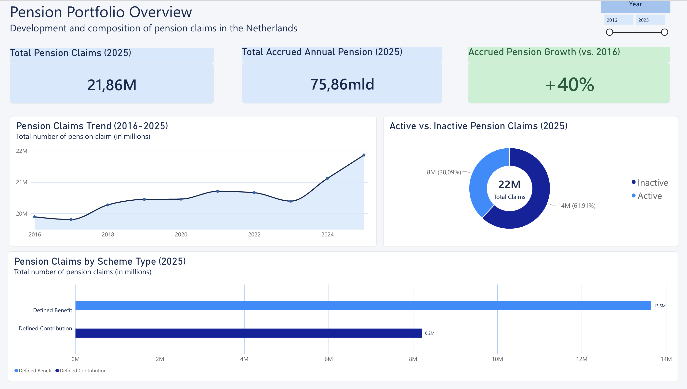

🏦 Pension Intelligence Platform

An end-to-end data engineering and business intelligence project analysing Dutch occupational pension statistics.

Built with Python, SQL, SQLite and Power BI, this project transforms public CBS data into structured, validated and analysis-ready insights.

  

  
  
  
  
  

⸻

📌 Project Overview

The Pension Intelligence Platform is an independent data engineering and business intelligence project built around Dutch occupational pension statistics.

It demonstrates a complete analytical workflow:

* API integration and data ingestion
* Data profiling and transformation
* Relational data warehousing
* SQL-based business analysis
* Automated data quality validation
* Data reconciliation and reporting
* Power BI dashboard development

The analysis covers 2016–2025 and focuses on pension claims, accrued pension amounts, claim status and pension scheme types.

🎯 Business Objectives

The project aims to answer several questions:

* How have occupational pension claims developed over time?
* How have accrued gross annual pension amounts changed?
* What proportion of pension claims are active versus inactive?
* How are pension claims distributed across defined benefit and defined contribution schemes?
* Can the source data be reconciled and validated reliably?

🛠️ Technology Stack

Technology	Purpose
Python	Data ingestion and pipeline orchestration
Pandas	Data processing and transformation
Requests	CBS OData API integration
SQLite	Relational data warehouse
SQL	Data modelling and business analysis
Pytest	Automated testing
Power BI	Business intelligence and visualisation
Git & GitHub	Version control

📊 Data Source

Statistics Netherlands (CBS)

Dataset: 84184NED — Arbeidsgerelateerd ouderdomspensioen; aanspraken, uitvoerders, regelingen.

The dataset provides annual statistics on occupational pension claims, pension providers and pension schemes.

The project uses three measures:

* Number of pension claims
* Accrued gross annual pension amount
* Potential gross annual pension amount

Monetary values are converted from thousands of euros into euros for reporting.

Important: Pension claims are not equivalent to unique individuals, and accrued annual pension amounts are not pension fund assets under management.

⚙️ Data Architecture

The pipeline follows a modular architecture, separating ingestion, transformation, storage, analysis and reporting.

flowchart TD
    A[CBS OData API] --> B[Python Ingestion]
    B --> C[Raw JSON Data]
    C --> D[Data Transformation]
    D --> E[SQLite Data Warehouse]
    E --> F[SQL Business Analysis]
    E --> G[Data Quality Checks]
    F --> H[Power BI Exports]
    G --> I[Reconciliation Report]
    H --> J[Power BI Dashboard]

Pipeline Components

Stage	Implementation
Ingestion	Retrieve observations and metadata from CBS
Transformation	Inspect and prepare source observations
Warehousing	Load dimension and fact tables into SQLite
Analysis	Execute SQL queries for pension trends
Data Quality	Validate completeness, consistency and reconciliation
Reporting	Generate analytical exports for Power BI

The pipeline is orchestrated through run_pipeline.py.

📈 Key Findings

Based on the extracted CBS observations:

Indicator	Result
Pension claims (2025)	21.86 million
Accrued gross annual pension amount (2025)	€75.86 billion
Growth in pension claims (2016–2025)	+9.9%
Growth in accrued pension amounts (2016–2025)	Approximately +40%
Inactive pension claim share (2025)	Approximately 61.9%

Interpretation

* The number of pension claims increased over the observation period.
* Accrued gross annual pension amounts grew faster than the number of claims.
* Inactive claims represented approximately 61.9% of total claims in 2025.

Data interpretation: Growth in accrued pension amounts is nominal and has not been adjusted for inflation. The statistics describe pension claims rather than unique individuals.

🔍 Data Quality & Validation

Data reliability is an important part of the platform.

Automated checks cover:

* Duplicate observations
* Missing numerical values
* Negative numerical values
* Reconciliation by pension claim status
* Reconciliation by pension scheme

Reconciliation Results

The reconciliation process evaluates aggregate totals against their corresponding category breakdowns.

Across 20 reconciliation outcomes:

Result	Count
Passed	17
Warnings	3

Three small discrepancies were identified in the original CBS source observations.

These discrepancies were traced back to the raw source data rather than introduced during transformation. They are reported transparently instead of being silently corrected.

🧪 Automated Testing

The project includes a Pytest suite covering data quality and reconciliation functionality.

Latest test result: 6 passed.

Run the tests locally using:

pytest -v

📁 Project Structure

pension-intelligence-platform/
├── data/                       # Generated data (not tracked)
├── docs/
│   └── architecture.md
├── powerbi/
│   ├── dashboard.png
│   └── exports/                # Generated CSV exports (not tracked)
├── sql/
│   ├── analysis_queries.sql
│   ├── data_quality_checks.sql
│   └── schema.sql
├── src/
│   ├── ingestion/
│   ├── transformation/
│   └── quality/
├── tests/
│   └── test_data_quality.py
├── .gitignore
├── README.md
├── requirements.txt
└── run_pipeline.py

🚀 Running the Project

1. Clone the repository

git clone https://github.com/emrepel03/-pension-intelligence-platform.git
cd -pension-intelligence-platform

2. Create and activate a virtual environment

python3 -m venv .venv
source .venv/bin/activate

3. Install dependencies

pip install -r requirements.txt

4. Run the complete pipeline

python run_pipeline.py

5. Run automated tests

pytest -v

The pipeline retrieves current data from the CBS API. Consequently, results may change when the source dataset is updated.

📚 Documentation

Additional technical documentation is available in the docs/ directory.

* System Architecture

⚠️ Disclaimer

This is an independent portfolio project developed for educational and analytical purposes using publicly available CBS statistical data.

It is not affiliated with Statistics Netherlands (CBS), AZL or any pension administrator.