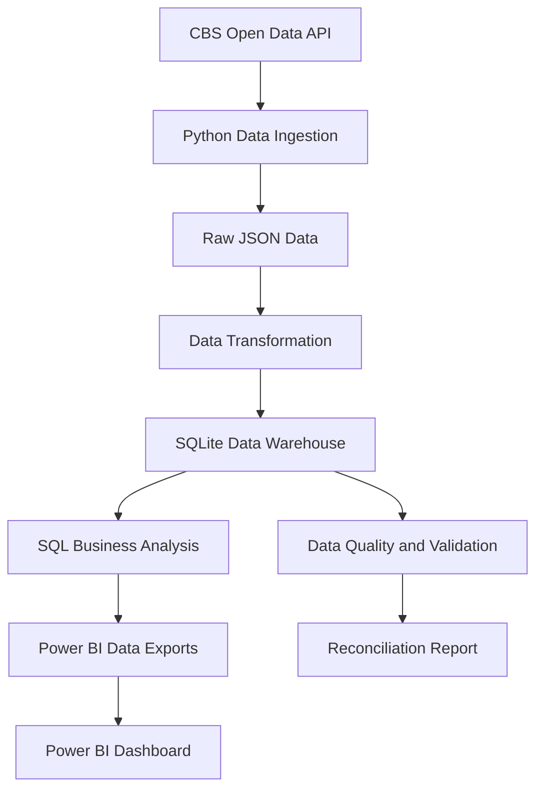

# System Architecture

## Overview

The Pension Intelligence Platform follows an end-to-end data pipeline, transforming public CBS pension statistics into structured analytical datasets and business intelligence reports.

## Data Flow



## Pipeline Components

| Component | Description |
|---|---|
| CBS API | Source of Dutch occupational pension statistics |
| Python Ingestion | Retrieves data through the CBS OData API |
| Raw Storage | Stores extracted observations |
| Transformation | Prepares observations for warehouse loading |
| SQLite Warehouse | Stores structured fact and dimension tables |
| SQL Analysis | Calculates pension trends and distributions |
| Data Quality | Validates completeness and consistency |
| Power BI | Presents business insights through an interactive dashboard |

## Data Warehouse

The warehouse contains five tables:

- `dim_pension_scheme`
- `dim_pension_provider`
- `dim_claim_status`
- `dim_period`
- `fact_pension_claims`

## Execution

Run the pipeline:

```bash
python run_pipeline.py
```

Run automated tests:

```bash
pytest -v
```